<div align="center">

# 🌳 Ech0 Mobile

**把自托管说说平台装进口袋。**

全功能 Android 原生客户端 · 不跳浏览器 · 写完就发

📖 **[操作指南](docs/GUIDE.md)** · 📥 **[下载最新版](https://github.com/salt-fishes/Ech0-Mobile/releases)** · 🖼 **[界面画廊](docs/screenshots-v3/README.md)** · 📝 **[更新记录](CHANGELOG.md)** · 🌐 **[项目介绍页源码](site/)**


</div>

---

## ✨ 界面预览

> 0.5.2 · 内置「纸张」背景 · 本地 mock 数据 · 状态栏固定 09:41
>
> 截图来自当前工作区构建（0.5.2 + 纸张调色 / 热力图修复），不是线上生产内容。

| 时间线 | 写说说 · 九图 | 发现 · 热力图 |
| :---: | :---: | :---: |
| 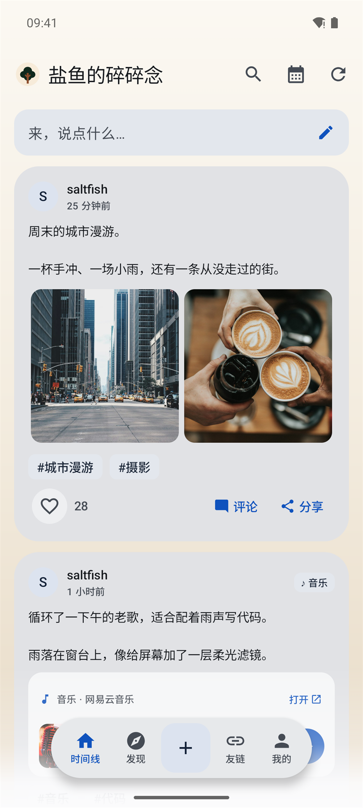 | 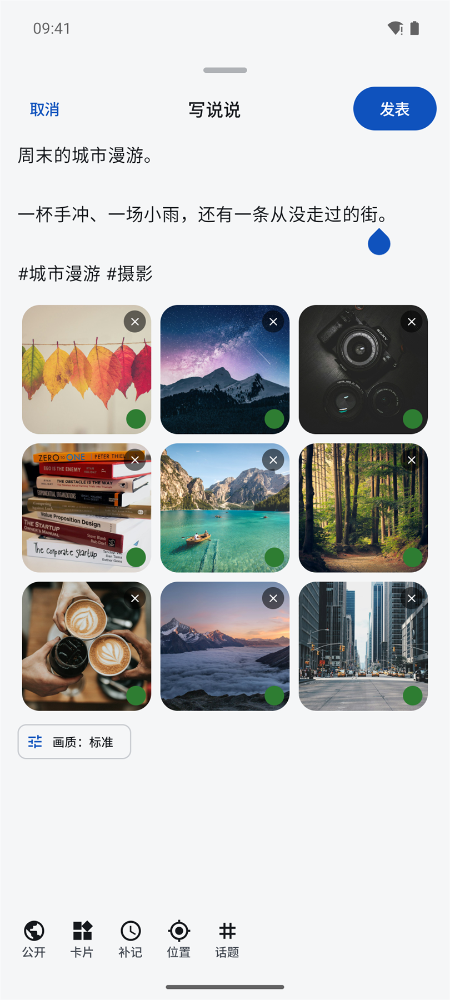 | 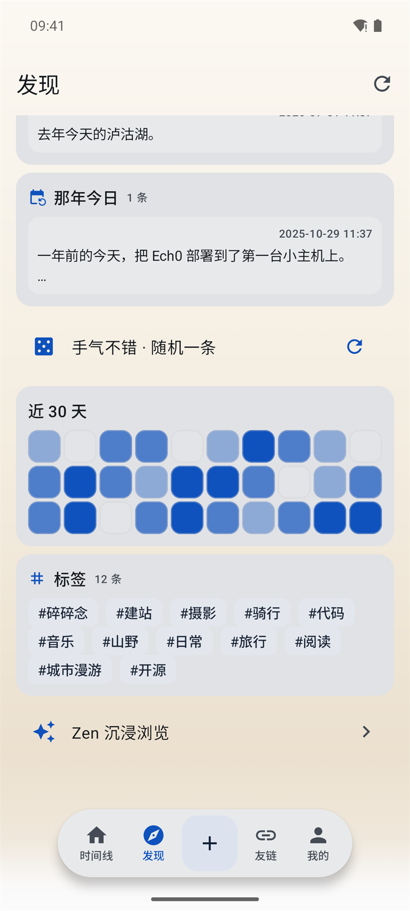 |

| 说说详情 · 二级评论 | 友链 · 跨实例聚合 | 设置 · 纸张 / 色盘 |
| :---: | :---: | :---: |
| 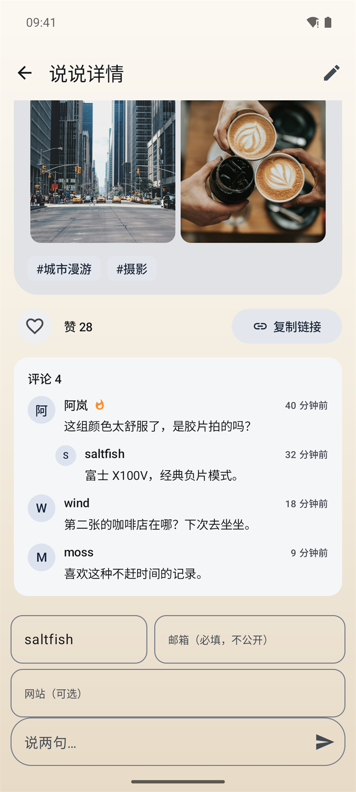 | 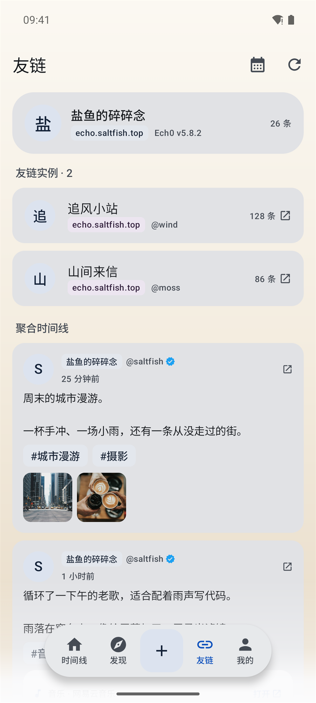 | 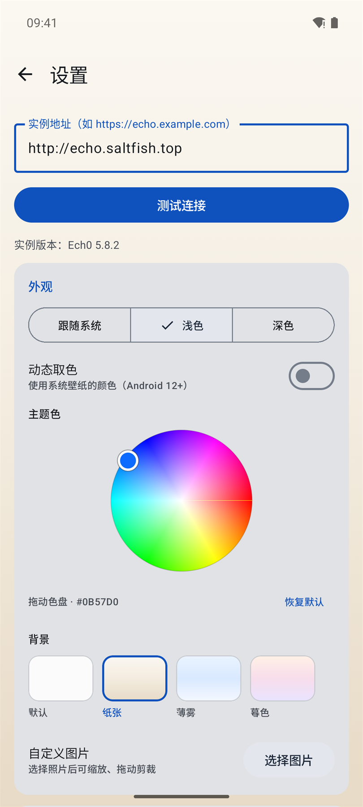 |

<details>
<summary><b>更多界面：扩展卡 / Zen / 九图 / 按月 / 关于 / 图片查看器</b></summary>

| | | |
| :---: | :---: | :---: |
| 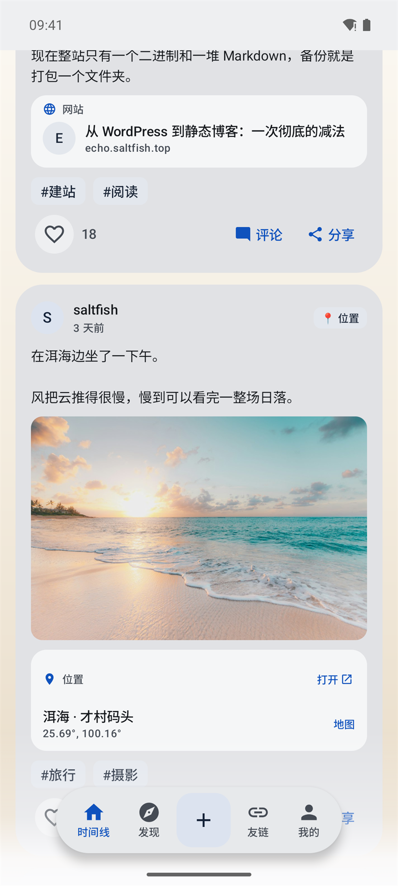 | 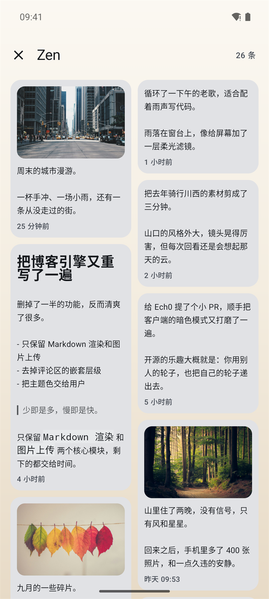 | 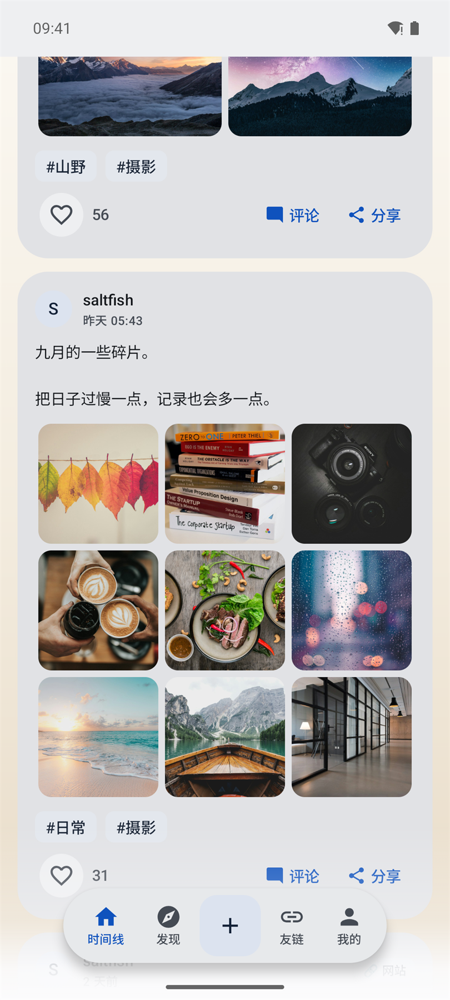 |
| 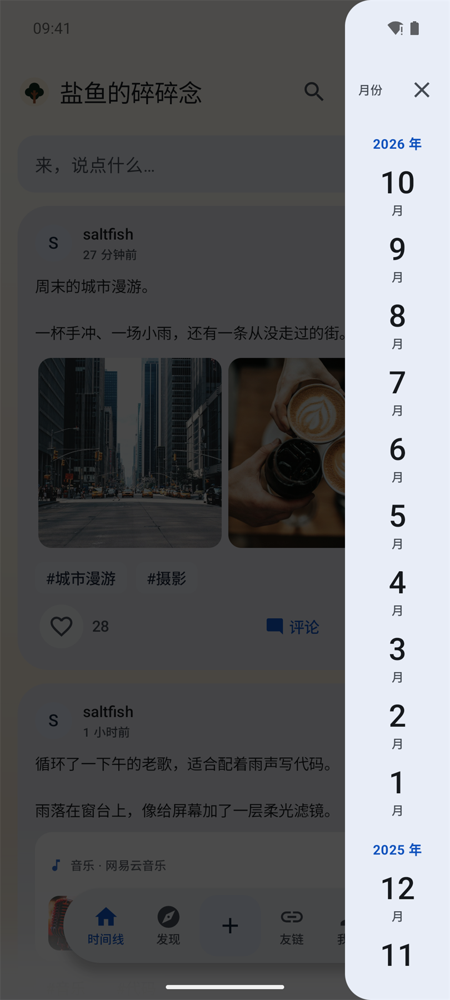 | 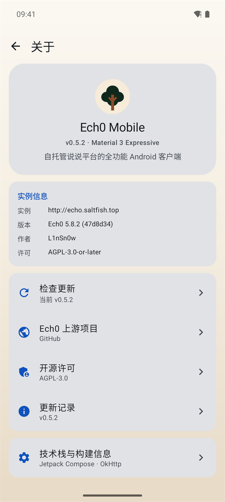 | 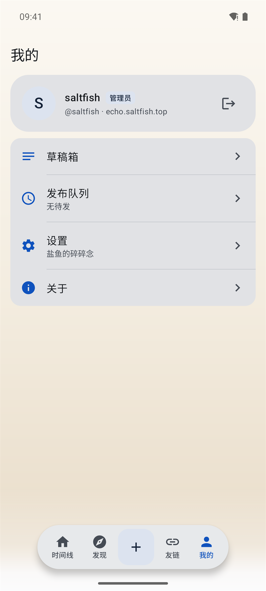 |
|  | 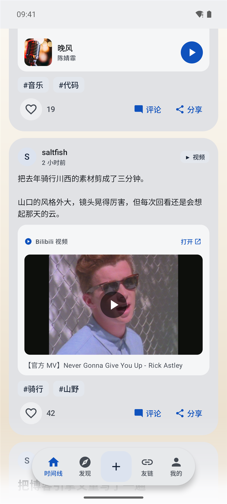 | 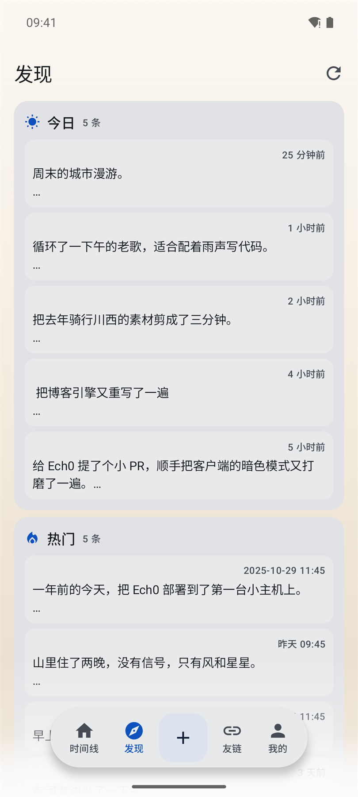 |
| 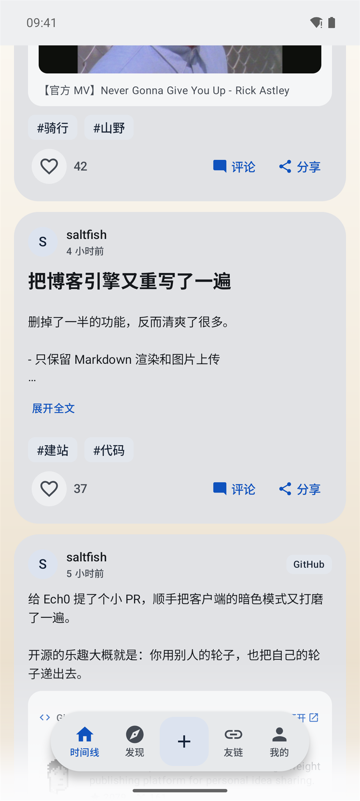 | | |

</details>

## 🎯 为什么是 Ech0 Mobile

- **全功能，不是“发布壳”** —— 时间线、详情、评论、发现、热力图、友链、草稿、队列都在 App 内完成；核心流程不跳 WebView。
- **写说说像 QQ 空间** —— 半屏抽屉 → 全屏编辑器，9 图九宫格，逐张压缩上传，公开 / 私密、话题、位置、补记、6 种扩展卡全部收在一条工具条里。
- **手机才有的能力** —— 相册多选、系统分享直达、桌面快捷方式「写一条」、断网队列、磁盘缓存秒开、图片缩放 / 保存 / 分享。
- **有审美的客户端** —— Material 3 Expressive 弹簧动效 + 悬浮 Dock + 纸张背景 + 160dp 主题色盘；明暗双形态都做过走查。

## 🚀 功能特性

### 📝 发布

- 抽屉式编辑器，可拖拽全屏；「取消 ｜ 写说说 ｜ 发表」三段式顶栏。
- Photo Picker 九宫格多图（≤9），逐张 WebP 压缩（标准 82 / 高清 92 / 原图），单张进度与重试。
- 6 种图片布局：waterfall / grid / horizontal / carousel / stack / none。
- 6 种扩展卡：网站 / 视频（B 站 / YouTube）/ 音乐（Meting）/ GitHub / 位置 / 推文；粘贴链接自动识别。
- 公开 / 私密切换、话题选择、补记时间、发布队列、草稿自动保存。
- 断网自动入队，WorkManager 指数退避补发；成功后刷新时间线。

### 🏠 浏览

- 分页信息流、关键词搜索、标签筛选、按时间 / 热度排序。
- Markdown 渲染：标题、粗斜、删除线、行内代码、链接、话题、提及、引用、列表；长文默认折叠。
- 图片布局按文件宽高比渲染；正文 Markdown 图片可直接显示、缩放。
- 详情页先显示缓存，再后台刷新；断网也能看已打开过的正文、图片和评论。
- 点赞单向（服务端无 unlike），列表页 / 详情页共用同一份计数与已赞状态。
- 长按删帖、编辑说说、复制链接、系统分享。

### 💬 互动

- 评论树、二级回复、置顶标记、评论计数。
- 游客评论：昵称 / 邮箱 / 网站 / 内容，form_token + 蜜罐；可选 gocap PoW 验证码在客户端本地求解。
- 回复提示、点评论聚焦输入框、离开页面自动清理回复目标。
- 默认评论身份，可保存昵称 / 邮箱 / 网站。

### 🔎 发现

- 今日 / 热门 / 那年今日 / 随机一条。
- 近 30 天热力图（0.5.2 修复刷新不更新）。
- 标签云（12+ 标签），点标签跳转时间线筛选。
- Zen 沉浸瀑布流：双列错落，只留内容与时间。

### 🌐 友链

- Connect 实例互联，本站 + 多个友链实例聚合时间线。
- 按来源分页，单个实例失败不拖垮整页；底部显示失败重试。
- 来源 chip、认证标记、服务端头像、远端详情与评论。

### 🎨 外观与系统

- 160dp 色相 / 饱和度色盘；拖动不带动页面滚动，停止 180ms 后落盘。
- Android 12+ 动态取色；浅色 / 深色 / 跟随系统。
- 4 套内置背景：默认 / 纸张 / 薄雾 / 暮色；自定义图片可缩放、拖动剪裁、模糊。
- 低流量模式：不请求头像、图片、扩展卡封面，只保留文字。
- 检查更新：启动静默检查 GitHub Release，关于页可手动检查；只做检查与下载引导，不自动安装。

> 管理面板、Copilot、Webhook 等高级能力仍在 Web；App 聚焦日常浏览、互动与发布。

## 📊 一眼看懂

| 指标 | 数据 |
|---|---|
| 发布版本 | 0.6.0（10 个公开版本） |
| 代码规模 | 33 个 Kotlin 文件 · 约 12,000 行 |
| 客户端 API | 40+ 个方法，覆盖内容 / 互动 / 认证 / 上传 / 友链 |
| 扩展卡 | 6 种 |
| 图片布局 | 6 种，单帖最多 9 图 |
| Release APK | 约 5.1 MB |
| 最低系统 | Android 10（minSdk 29） |

## 📥 下载

从 [Releases](https://github.com/salt-fishes/Ech0-Mobile/releases) 下载最新 APK（Android 10+）。

- 当前版本：`0.6.0`
- 覆盖安装旧版本会保留数据，但必须使用同一张 release 签名
- 版本检查仓库：`salt-fishes/Ech0-Mobile`，入口在「关于 → 检查更新」

## 🔧 构建

```bash
# JDK 17+，Android SDK 见 local.properties；依赖走阿里云镜像
./gradlew :app:assembleDebug
adb install -r app/build/outputs/apk/debug/app-debug.apk

# Release 签名：复制签名凭据文件（不入库）
cp keystore.properties.example keystore.properties  # 并填入自己的 keystore 信息
./gradlew :app:assembleRelease
```

签名、发版步骤与 Release 文案格式见 [`docs/release/README.md`](docs/release/README.md) 和 [`docs/release/FORMAT.md`](docs/release/FORMAT.md)。

## 📖 使用

1. 首次进入按引导连接你的 Ech0 实例（如 `https://echo.example.com`）
2. 「我的 → 登录」管理员账号后即可发布（或「设置 → 高级」粘贴 Access Token）
3. 桌面长按图标「写一条」、系统分享文字 / 图片均可直达编辑器
4. 想检查客户端新版本：「我的 → 关于 → 检查更新」

完整步骤、Token 权限配置和常见问题见 **[操作指南](docs/GUIDE.md)**。

## 🧱 技术栈

| 层 | 选型 |
|---|---|
| UI | Jetpack Compose · **Material 3 Expressive**（MaterialExpressiveTheme / MotionScheme / 波浪指示器 / FilledIconToggle） |
| 构建 | AGP 9.3 · Kotlin 2.4 · Compose Multiplatform 1.12（Android 落地为 androidx） |
| 网络 | OkHttp（401 自动续期重放 / multipart 进度上传 / CookieJar）· kotlinx.serialization |
| 存储 | DataStore（Keystore 加密令牌）· 磁盘缓存（时间线 / 发现 / 友链 / 详情） |
| 图片 | Coil · 自实现图片查看器（缩放 / 拖动 / 保存 / 分享） |
| 后台 | WorkManager 发布队列（网络约束 + 指数退避） |
| 异步 | Coroutines / Flow · MVVM（ViewModel + Repository） |

## 📂 工程结构

```
app/src/main/java/top/saltfish/ech0/
├── Ech0App / MainActivity        # 入口；快捷方式 / 分享意图 → 编辑器
├── data/                         # DTO / API / DataStore / 缓存 / Release 检查
├── media/Compressor.kt           # 长边 2048 · WebP 压缩
├── publish/ + work/              # 草稿箱 · 发布队列 · WorkManager
└── ui/
    ├── AppRoot.kt                # MD3E 主题 + 悬浮 Dock + 转场导航
    ├── common/                   # 设计系统与共享组件（Markdown / 媒体网格 / 扩展卡）
    ├── timeline/ · detail/       # 时间线 · 本站 / 远端详情
    ├── composer/                 # 抽屉 / 全屏编辑器 · 扩展卡编辑器
    ├── discover/                 # 今日 / 热门 / 热力图 / Zen
    ├── hub/                      # 友链聚合
    └── me/                       # 我的 / 设置 / 草稿 / 队列 / 关于

mock/server.mjs                   # 本地 mock 实例（26 条说说 / 12 标签 / 2 友链）
docs/screenshots-v3/              # 0.5.2 界面截图（16 张 + 拍摄说明）
docs/release/                     # 发版说明、格式规范与模板
```

## 🎨 设计

- **纸张背景**：0.5.2 把浅色纸张调成 `#FBF8F2 → #F3ECDF → #E7DAC6`，深色纸张调成 `#2A241D → #1A1511`，降低橙黄饱和度，和卡片留白更协调。
- **主题色盘**：160dp 色相 / 饱和度圆盘，默认蓝 `#0B57D0`，恢复默认一键返回。
- **动效**：M3 expressive 弹簧、抽屉拖拽、列表增删位移、点赞形变、shared-axis X 页面转场。
- **无障碍**：保留 Compose 语义与系统预测性返回；错误用 ErrorCard / Snackbar 两套层级。

## 📝 发版

- 版本号、Tag、Release 标题与正文、APK 命名统一遵守 [`docs/release/FORMAT.md`](docs/release/FORMAT.md)。
- 每个版本的 Release 正文来自 `docs/release/X.Y.Z.md`，由 GitHub Actions 在推送 `vX.Y.Z` tag 时自动构建并发布。
- 完整变更见 [`CHANGELOG.md`](CHANGELOG.md)。

## 📄 开源许可

- 本客户端：**AGPL-3.0**
- 上游 [Ech0](https://github.com/lin-snow/Ech0)：AGPL-3.0-or-later，作者 L1nSn0w
- 界面截图数据来自本地 mock（`mock/server.mjs`），图片为 Unsplash 演示图；不代表真实生产内容

<div align="center">

**如果这个客户端对你有帮助，欢迎点一个 ⭐ Star**

</div>
