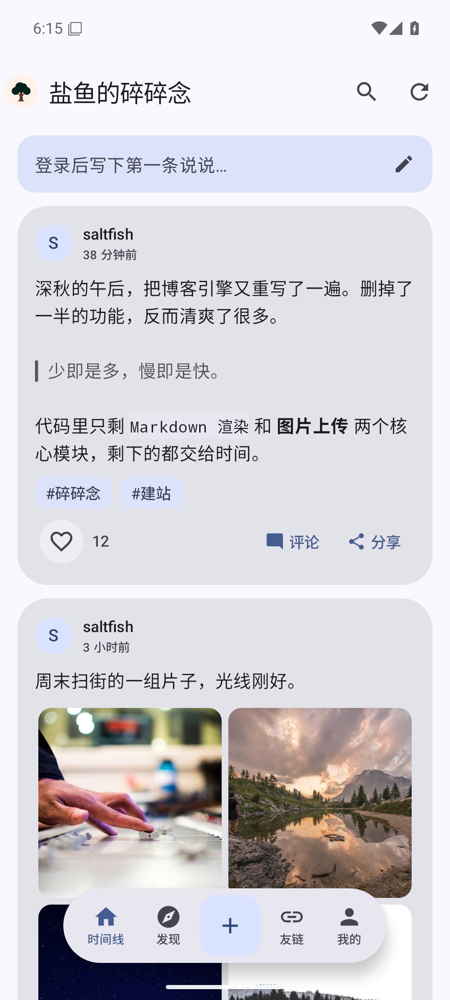
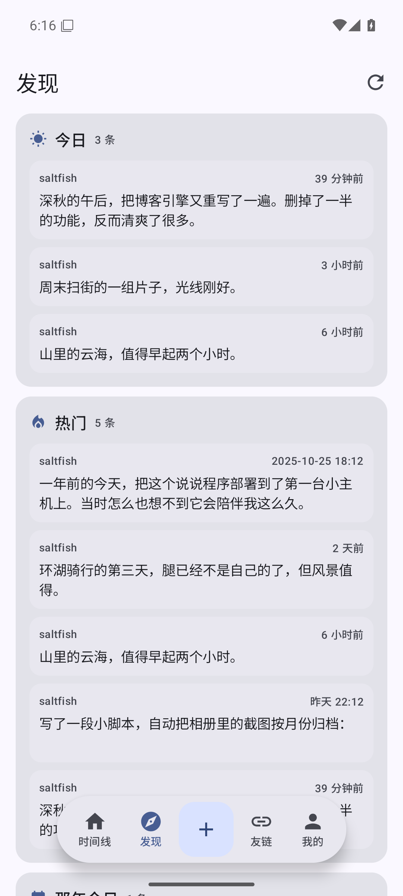
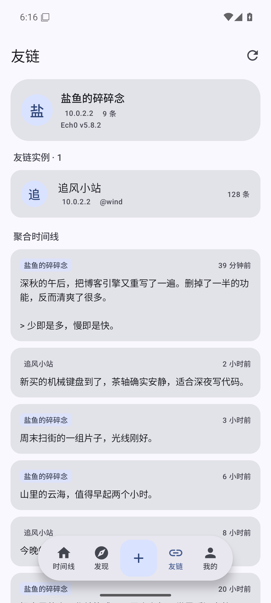
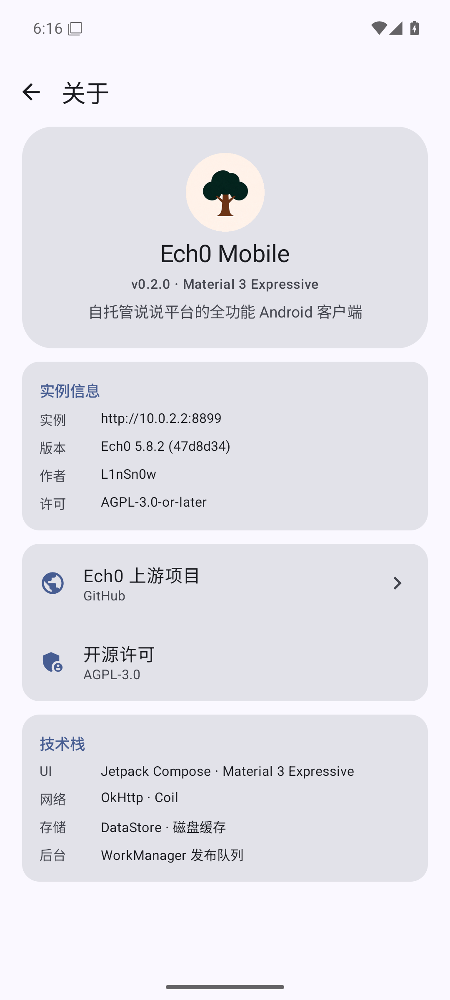

<div align="center">

# 🌳 Echo Mobile

**自托管说说平台 [Ech0](https://github.com/lin-snow/Ech0) 的全功能 Android 原生客户端**

随手写 · 随手发 · 随手看


</div>

---

## ✨ 界面预览

| 时间线 | 发现 |
| :---: | :---: |
|  |  |

| 友链聚合 | 我的 · 关于 |
| :---: | :---: |
|  |  |

> 界面全面采用 **Material 3 Expressive**：动态取色 · 弹簧动效 · 形变组件 · 沉浸式顶栏 · 悬浮 Dock

## 🚀 功能特性

- 📝 **写说说** —— 抽屉式编辑器（可拖拽全屏）、Photo Picker 九宫格多图、逐张压缩上传（WebP · 可关）、话题标签、公开/私密切换、6 种图片布局、6 种扩展卡片（网站/视频/音乐/GitHub/位置/推文）、补记时间、草稿自动保存、断网自动入队（WorkManager 指数退避补发）
- 🏠 **时间线** —— 分页信息流、关键词搜索、Markdown 渲染（粗斜删/行内代码/链接/话题/提及/标题/引用）、点赞（幂等去重 + 弹簧动效）、分享、长按删帖
- 🔎 **发现** —— 今日 / 热门 / 那年今日、30 天热力图、标签云、随机一条、Zen 沉浸瀑布流
- 🌐 **友链** —— Connect 实例互联，跨实例时间线按时间归并聚合
- 💬 **详情与评论** —— 评论树、回复、游客评论（form_token + 蜜罐 + gocap PoW 验证码客户端实现）
- ⚡ **体验** —— 时间线/发现/友链**磁盘缓存秒开**（先显缓存再后台刷新，离线可看）、Android 12+ 动态取色、站点 Logo 自动获取、深色模式、edge-to-edge + 预测性返回
- 🔐 **账号** —— 用户名密码登录（JWT 自动续期）、Access Token 登录、发布队列管理、草稿箱

## 📥 下载

从 [Releases](../../releases) 下载最新 APK 安装即可（Android 10+）。

## 🔧 构建

```bash
# JDK 17+，Android SDK 见 local.properties；依赖走阿里云镜像
./gradlew :app:assembleDebug
adb install -r app/build/outputs/apk/debug/app-debug.apk

# Release 签名：复制签名凭据文件（不入库）
cp keystore.properties.example keystore.properties  # 并填入自己的 keystore 信息
./gradlew :app:assembleRelease
```

## 📖 使用

1. 首次进入按引导连接你的 Ech0 实例（如 `https://echo.example.com`）
2. 「我的 → 登录」管理员账号后即可发布（或「设置 → 高级」粘贴 Access Token）
3. 桌面长按图标「写一条」、系统分享文字/图片均可直达编辑器

## 🧱 技术栈

| 层 | 选型 |
|---|---|
| UI | Jetpack Compose · **Material 3 Expressive**（MaterialExpressiveTheme / MotionScheme / 波浪指示器 / FilledIconToggle） |
| 构建 | AGP 9.3 · Kotlin 2.4 · Compose Multiplatform 1.12（Android 落地为 androidx） |
| 网络 | OkHttp（401 自动续期重放 / multipart 进度上传）· Coil |
| 存储 | DataStore（Keystore 加密令牌）· 磁盘缓存 |
| 后台 | WorkManager 发布队列（网络约束 + 指数退避） |

## 📂 工程结构

```
app/src/main/java/top/saltfish/ech0/
├── Ech0App / MainActivity        # 入口；快捷方式/分享意图 → 编辑器
├── data/                         # DTO / API 客户端 / DataStore / 磁盘缓存
├── media/Compressor.kt           # 长边 2048 · WebP 压缩
├── publish/ + work/              # 草稿箱 · 发布队列 · WorkManager
└── ui/
    ├── AppRoot.kt                # MD3E 主题 + 悬浮 Dock + 转场导航
    ├── common/                   # 设计系统与共享组件
    └── timeline/ · detail/ · composer/ · discover/ · hub/ · me/
```

## 📄 开源许可

- 本客户端：**AGPL-3.0**
- 上游 [Ech0](https://github.com/lin-snow/Ech0)：AGPL-3.0-or-later，作者 L1nSn0w
- 界面截图数据来自本地 mock（`tools/mock_server.py`），图片为 picsum.photos 占位图

<div align="center">

**如果这个客户端对你有帮助，欢迎点一个 ⭐ Star**

</div>
